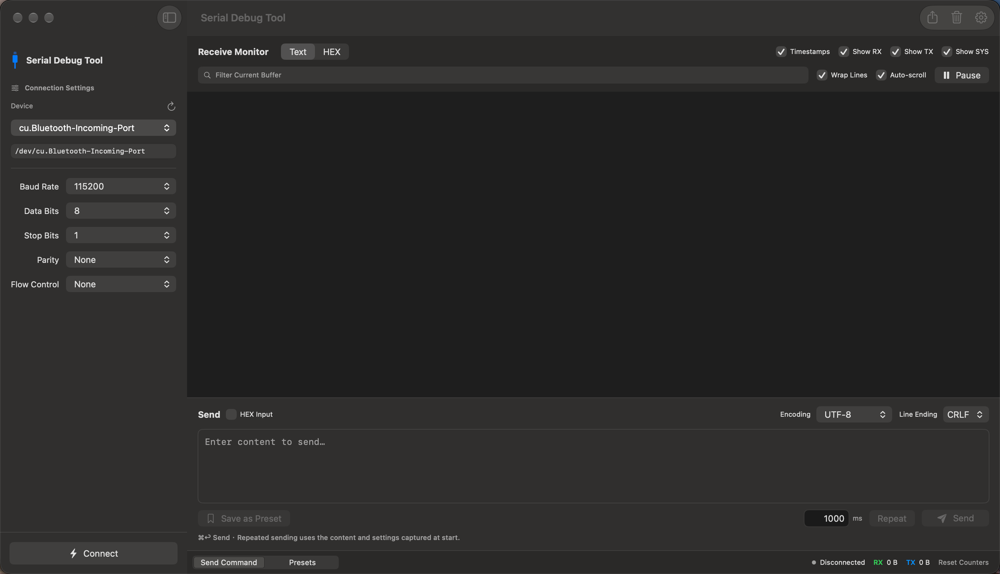

  

<h1 align="center">Serial Debug Tool</h1>

  English · <a href="README.zh-CN.md">简体中文</a>

> Built entirely by Codex. The human mostly clicked “Continue” — and occasionally asked, “Why is that button over there?”

A native macOS serial debugging tool built with Swift, SwiftUI, and AppKit.

## Screenshot

## Download

Download the macOS app directly from [Releases](https://github.com/txgde-space/serial_debug_tool/releases). Extract the ZIP and move **Serial Debug Tool.app** to **Applications** — no Xcode required.

## Features

- **Multiple windows** — Press **⌘N** to open a new serial window. Each window has its own connection, log, and send draft.
- **Multiple command presets** — Save multiple commands, edit them inline, and choose between **Send Once** and **Repeat** with an adjustable interval.

## Build from Source

Open `Serial Debug Tool.xcodeproj` in Xcode, select the **Serial Debug Tool** scheme and **My Mac**, then run. Choose a serial port, configure the connection, and click **Connect**.

Requires macOS 14 or later.
